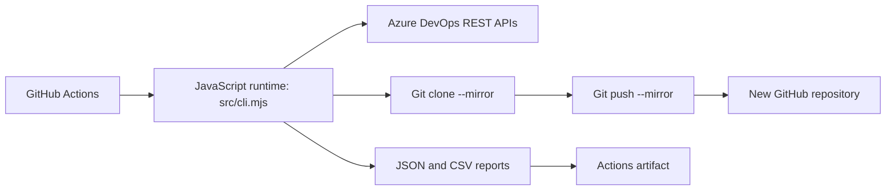

# 1. GitBridge: ADO to GitHub Migration Toolkit

GitBridge is a **GitHub Actions-only toolkit** for Azure DevOps discovery and guarded Git mirror migration. It is for teams moving Git repositories from Azure DevOps to GitHub. It is not a standalone application and has no web dashboard.

> **MVP status:** Local and mocked tests pass. No live customer-tenant discovery or migration has been verified. GitHub settings migration, bulk migration, and LFS transfer are not implemented.

**Quick start:** Store `ADO_PAT` as a GitHub Actions repository secret. Run **Actions > 01 - ADO Full Discovery (Organization + Selected Projects)**. Leave both project inputs blank to discover all accessible projects.

## 2. What Is GitBridge?

GitBridge runs in GitHub Actions. Its JavaScript runtime calls Azure DevOps REST APIs. It uses standard Git commands for repository data:

- `git clone --mirror`
- `git push --mirror`

GitBridge does not use `ado2gh` as its migration engine. There is no app to install or dashboard to host.

## 3. Key Features

| Feature | Current status |
|---|---|
| Discover accessible ADO projects | Implemented; all, one, or comma-separated project selection |
| Repository metadata, branches, tags, commits | Implemented; paginated API adapters |
| Policies, ACLs, build/release definitions, service connection metadata | Implemented as discovery adapters; access depends on PAT permissions |
| LFS configuration | Bounded scan of default-branch `.gitattributes`; does not verify LFS objects |
| Migration dry-run | Read-only metadata checks; does not clone, push, or create a repository |
| Git mirror migration | One repository per run; guarded against existing targets |
| Post-migration validation | Branch/tag name comparison only |
| GitHub org settings, branch protection, teams, access mapping | Not implemented |

## 4. How GitBridge Works

1. A manual GitHub Actions workflow starts the JavaScript runtime.
2. The runtime authenticates to ADO using `ADO_PAT` and lists accessible projects.
3. It inventories the selected projects and writes JSON/CSV files to `reports/`.
4. The workflow uploads those files as a downloadable artifact.
5. A separate dry-run workflow checks metadata and target visibility without writes.
6. A separate migration workflow clones one source repository as a mirror, creates a new GitHub repository, and pushes the mirror.
7. A separate validation workflow compares branch and tag names.

## 5. Architecture Overview



GitHub Actions is the execution platform. The active implementation is `src/cli.mjs`.

## 6. Current Implementation Status

**Implemented:** ADO project/repository discovery, refs and commits, policy/ACL and pipeline/service-connection metadata adapters, bounded LFS configuration inspection, JSON/CSV reporting, one-repository mirror migration, and branch/tag-name validation.

**Locally tested:** API adapters with mocked responses and Git mirror behavior using temporary local bare repositories. The local fixture verifies multiple commits, branches, tags, and ref/object-ID parity.

**Not live-verified:** ADO or GitHub tenant permissions, actual connectivity, and customer-sized repositories.

## 7. Prerequisites

- A private GitHub repository containing GitBridge.
- Node.js 20+ and Git 2.30+ for local checks.
- An organization-scoped ADO PAT stored as a GitHub Actions secret.
- `GH_MIGRATION_TOKEN` only for dry-run, migration, and validation workflows.
- A protected GitHub Environment named `migration-approval` with required reviewers before migration.

There are no npm dependencies or lockfile. `npm ci` is not supported.

## 8. Initial Setup

1. On GitHub, select **+ > New repository**. Enter the repository name, choose **Private**, leave README/license/gitignore initialization unchecked, and select **Create repository**.
2. Open **Settings > Secrets and variables > Actions > New repository secret** and add `ADO_PAT`. Use the narrow scopes in section 9.
3. Add `GH_MIGRATION_TOKEN` only if you will run the other three workflows. Discovery does not use it.
4. For migration approval, open **Settings > Environments > New environment**, enter `migration-approval`, and add required reviewers.
5. Open **Actions** and run the discovery workflow.

## 9. Required ADO PAT Scopes

Select only the read scopes needed for the adapters you want. The PAT owner must also have access to the relevant ADO projects/resources.

| API area | Microsoft scope | Use |
|---|---|---|
| Projects | Project and team (read), `vso.project` | Required to list projects |
| Repositories, branches, tags, commits, Git items, policies | Code (read), `vso.code` | Required for Git discovery and policy adapter |
| Build definitions | Build (read), `vso.build` | Needed for build metadata |
| Release definitions | Release (read), `vso.release` | Needed for release metadata |
| Service connections | Service endpoints (read), `vso.serviceendpoint` | Needed for endpoint metadata |
| Repository ACLs | **Unresolved** | The ACL API documents PAT Basic authentication but does not identify a required scope. Ask your ADO administrator; do not assume Security (manage) is least privilege. |

The runtime attempts all adapters. Missing optional scopes can produce `NOT_VERIFIED` or `PARTIAL` statuses. Microsoft documentation: [PAT guidance](https://learn.microsoft.com/en-us/azure/devops/organizations/accounts/use-personal-access-tokens-to-authenticate?view=azure-devops), [OAuth scope catalog](https://learn.microsoft.com/en-us/azure/devops/integrate/get-started/authentication/oauth?view=azure-devops), and [ACL query API](https://learn.microsoft.com/en-us/rest/api/azure/devops/security/access-control-lists/query?view=azure-devops-rest-7.1).

## 10. GitHub Repository Secrets

| Secret | Workflows | Purpose |
|---|---|---|
| `ADO_PAT` | All four | Authenticate to Azure DevOps |
| `GH_MIGRATION_TOKEN` | Dry-run, migrate, validate | Read destination metadata; migration also creates the destination and writes Git contents |

The discovery workflow needs only `ADO_PAT`. No secret named `GITHUB_TOKEN` is required; GitHub supplies the Actions token used by workflow actions.

For `GH_MIGRATION_TOKEN`, the GitHub App installation or fine-grained token needs repository **Contents: write** for the mirror push, **Metadata: read** for repository lookup, and organization repository-creation permission. GitHub's fine-grained token permission reference lists **Administration: write** for `POST /orgs/{org}/repos`. The authenticated identity must also be an organization member allowed to create repositories. For a classic PAT, GitHub documents `repo` for private-repository creation; use a fine-grained token or GitHub App when possible. See [Create an organization repository](https://docs.github.com/en/rest/repos/repos#create-an-organization-repository) and [fine-grained token permissions](https://docs.github.com/en/rest/authentication/permissions-required-for-fine-grained-personal-access-tokens).

## 11. Configure and Run Workflows

Open **Actions**, select a workflow, choose **Run workflow**, select the branch, enter the listed inputs, then start the run.

| Workflow | Purpose |
|---|---|
| `01 - ADO Full Discovery (Organization + Selected Projects)` | Read-only ADO inventory |
| `02 - Migration Dry Run` | Read-only source inventory and target visibility check |
| `03 - Migrate One Git Repository` | Guarded, one-repository Git mirror migration |
| `04 - Post Migration Validation` | Branch/tag-name comparison |

## 12. Discover All Projects

Run the discovery workflow and enter:

- `ado_org_url` (required string): `https://dev.azure.com/<ADO_ORG>`.
- `ado_project` (optional string): leave blank.
- `ado_projects` (optional string): leave blank.

Replace `<ADO_ORG>` with your organization name. Example: `https://dev.azure.com/contoso`.

## 13. Select One or Multiple Projects

For one project, enter its exact name in `ado_project`; leave `ado_projects` blank.

For multiple projects, enter comma-separated names in `ado_projects`; leave `ado_project` blank. Example input:

```text
Platform,Payments
```

Replace those examples with exact project names visible to the PAT owner. Do not fill both selection inputs. Matching is case-insensitive; a name not found in the accessible project list fails selection.

## 14. Run Migration Dry-Run

Run **02 - Migration Dry Run**. All three inputs are required strings:

- `ado_org_url`: full HTTPS organization URL.
- `ado_project`: one project name.
- `target_owner`: GitHub organization name.

Dry-run checks repository metadata and target visibility. It does not test Git credentials or write/create anything, and it cannot prove the token can create a repository.

## 15. Migrate One Repository

Migration is a write operation. Review discovery and dry-run artifacts first. Confirm the source freeze/rollback plan and configure the protected `migration-approval` environment.

Run **03 - Migrate One Git Repository** with:

- `ado_org_url` (required string): full HTTPS organization URL.
- `ado_project` (required string): exact project name.
- `target_owner` (required string): GitHub organization name.
- `repository` (required string): exact source repository name.
- `confirm_migration` (required boolean, default `false`): set to `true` only after review. The job is skipped unless true.
- `target_private` (required boolean, default `true`): keep true unless public visibility is approved.

The workflow refuses an existing target. It clones the source before creating a new destination. A push failure after creation writes a `FAILED` report with `pushMayBePartial`; inspect the target before retrying. Migration is one repository per run, not bulk migration.

## 16. Download Reports

Open the Actions run, scroll to **Artifacts**, and download the artifact ZIP. Discovery artifact: `ado-discovery-<RUN_NUMBER>`; retention is 30 days.

The flat `reports/` directory contains organization/project/repository JSON and CSV, `ado-full-inventory.json`, and detail CSVs for projects, repositories, branches, tags, commits, branch policies, build pipelines, release pipelines, service connections, and repository permissions. There is no Markdown/HTML report or consolidated ZIP generated by the runtime; GitHub wraps uploaded files in a downloadable artifact.

Migration artifacts are `migration-dry-run-<RUN_NUMBER>` (30 days), `migration-execution-<RUN_NUMBER>` (90 days), and `post-migration-validation-<RUN_NUMBER>` (90 days).

## 17. Validate Migration

Run **04 - Post Migration Validation** with required string inputs `ado_org_url`, `ado_project`, `target_owner`, and `repository`.

It compares source and target branch/tag names. It does not compare all commit objects, LFS objects, settings, or other ADO assets. Check the report’s missing branches/tags and review the stated limitations before sign-off.

## 18. Troubleshooting

| Result | Check |
|---|---|
| 401 / `NOT_VERIFIED` | Check `ADO_PAT` is present, active, organization-scoped, and has the required read scopes. |
| 403 / `NOT_VERIFIED` | Check the PAT owner’s ADO permissions and relevant PAT scope. ACL scope requires administrator verification. |
| Empty project/repository list | The API lists only resources visible to the PAT owner. Compare with an authorized ADO UI view. |
| Requested project unavailable | Check exact spelling and access. Use only one of `ado_project` or `ado_projects`. |
| Target not visible in dry-run | Dry-run cannot distinguish every permission/visibility condition or confirm repository-creation rights. |
| Push failed after repository creation | Read `migration-execution.json`; inspect the target before retrying. Existing targets are never overwritten. |
| LFS `NOT_VERIFIED` | A scan limit/default-branch issue prevented a complete configuration scan. LFS objects are not transferred or validated. |

Local checks, run from the project directory (replace `<GITBRIDGE_DIRECTORY>` with its actual path):

```sh
cd "<GITBRIDGE_DIRECTORY>"
npm test
npm run check
```

## 19. Security Considerations

- Store `ADO_PAT` and `GH_MIGRATION_TOKEN` only as GitHub Actions secrets. Never put tokens in inputs, URLs, source files, reports, or logs.
- Use short-lived credentials and the narrowest approved permissions. The ADO ACL scope is not conclusively established; do not grant Security (manage) without administrator approval.
- ADO requests require validated HTTPS organization URLs and reject redirects. Git remotes are checked against the configured ADO organization and GitHub host.
- Git credentials use temporary askpass scripts, which are cleaned up after each operation. Git child-process errors are redacted.
- Service connection URLs are reduced to origins; authorization/data fields, commit messages, and author email addresses are not exported.
- Limit access to workflow runners and downloaded artifacts. Discovery artifacts include internal repository names, ACL descriptors, and pipeline metadata.
- Migration requires explicit confirmation and a protected environment. Set required reviewers in GitHub repository settings.

## 20. Known Limitations

- No live tenant discovery or migration has been verified by the local tests.
- GitHub org settings, branch protection/rulesets, teams, variables, and repository access mapping are not implemented.
- One repository can be migrated per workflow run; there is no bulk migration.
- Git mirror moves Git data only. It does not migrate pull requests, work items, pipelines/releases, policies, permissions, service connections, wikis, test plans, or artifacts.
- LFS detection scans the default branch under limits of 100,000 tree items, 2,000 directory requests, and 100 `.gitattributes` files. It does not prove LFS object availability and does not transfer LFS objects.
- Post-migration validation compares branch/tag names only.
- `config/migration.yml` is an example file; the runtime does not load it.
- `GH_MIGRATION_TOKEN` creation/rotation is not automated.

## 21. Roadmap

Possible future work, not implemented today: confirm the least-privilege ACL permission, add full object/LFS validation and transfer, support bulk migration with safe recovery, implement GitHub settings/team mapping, and add more live-like integration tests and report formats.

## 22. Contribution and License

No contribution guide or license file is included. Do not assume the project is open source or reuse it under a license until the owner adds one.
